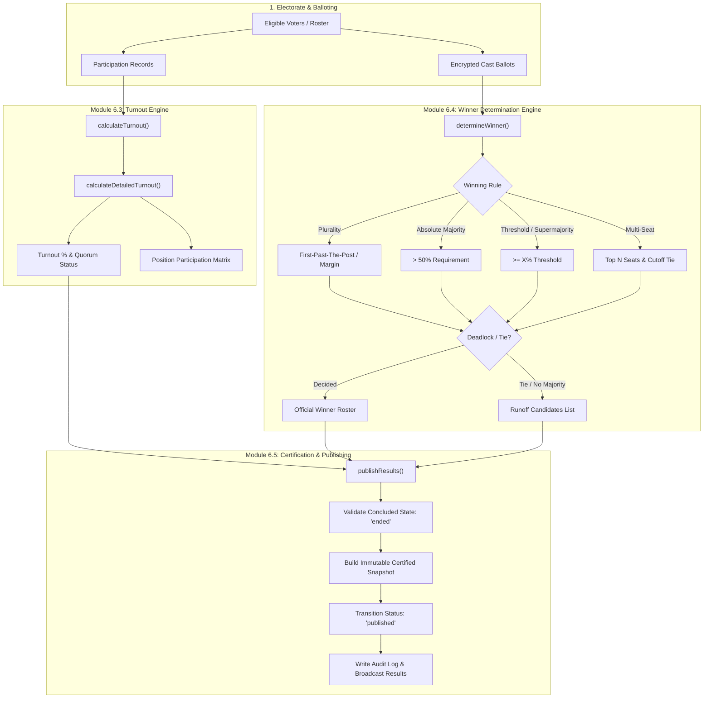

# VoteSphere Engine Walkthrough: Modules 6.3, 6.4 & 6.5

This document details the architectural design, algorithmic formulas, data contracts, and verification suite for **Phase 6 (Results Engine)** of VoteSphere:
- **Module 6.3: Turnout Calculation & Quorum Assessment**
- **Module 6.4: Winner Determination & Multi-Rule Tie Resolution**
- **Module 6.5: Results Publishing & Official Snapshot Certification**

---

## 1. Architectural Overview & System Flow



---

## 2. Module 6.3: Turnout Calculation & Quorum Assessment

### 2.1 Core Objectives
- Accurately compute election-level participation percentages without division-by-zero errors.
- Evaluate organizational quorum thresholds (`quorumPercentage`).
- Calculate position-specific participation rates to detect ballot drop-off.
- Segregate active electors, voted voters, and disqualified records.

### 2.2 Mathematical Formulas & Invariants

$$\text{Turnout Percentage} = \begin{cases} 
\left( \frac{\text{Total Voted}}{\text{Total Eligible}} \right) \times 100 & \text{if Total Eligible} > 0 \\ 
0 & \text{if Total Eligible} = 0 
\end{cases}$$

$$\text{Remaining Unvoted Count} = \max(0, \text{Total Eligible} - \text{Total Voted} - \text{Disqualified Count})$$

$$\text{Quorum Required Votes} = \left\lceil \frac{\text{Total Eligible} \times \text{Quorum Target \%}}{100} \right\rceil$$

$$\text{Quorum Met} = \begin{cases} 
\text{Turnout \%} \ge \text{Quorum Target \%} & \text{if Quorum Target \%} > 0 \\ 
\text{true} & \text{if Quorum Target \%} = 0 
\end{cases}$$

$$\text{Quorum Deficit} = \begin{cases} 
0 & \text{if Quorum Met} = \text{true} \\ 
\max(0, \text{Quorum Required Votes} - \text{Total Voted}) & \text{if Quorum Met} = \text{false} 
\end{cases}$$

### 2.3 Implementation Details

Located in [`lib/results/calculation.js`](file:///d:/projects/voteSphare/lib/results/calculation.js):

```javascript
export async function calculateTurnout(electionId) {
  const totalEligible = await Eligibility.count({ where: { electionId } });
  const totalVoted = await Eligibility.count({ where: { electionId, status: 'voted' } });
  const disqualifiedCount = await Eligibility.count({ where: { electionId, status: 'disqualified' } });

  const turnoutPercentage =
    totalEligible > 0 ? Number(((totalVoted / totalEligible) * 100).toFixed(2)) : 0;

  return {
    totalEligible,
    totalVoted,
    turnoutPercentage,
    disqualifiedCount,
  };
}
```

Detailed position-level breakdown & quorum calculation:
```javascript
export async function calculateDetailedTurnout(electionId) {
  const election = await Election.findByPk(electionId, {
    attributes: ['id', 'title', 'status', 'config', 'startDate', 'endDate'],
    include: [{ model: Position, as: 'positions', attributes: ['id', 'name', 'order'] }],
  });

  const basicTurnout = await calculateTurnout(electionId);
  const quorumTarget = election.config?.quorumPercentage || 0;
  const quorumMet = quorumTarget > 0 ? basicTurnout.turnoutPercentage >= quorumTarget : true;
  const quorumVotesRequired = quorumTarget > 0 ? Math.ceil((basicTurnout.totalEligible * quorumTarget) / 100) : 0;

  // Aggregate vote cast counts by position
  const votes = await Vote.findAll({ where: { electionId }, attributes: ['positionId'] });
  const positionVoteCounts = new Map();
  for (const v of votes) {
    positionVoteCounts.set(v.positionId, (positionVoteCounts.get(v.positionId) || 0) + 1);
  }

  const positionParticipation = (election.positions || []).map((pos) => {
    const cast = positionVoteCounts.get(pos.id) || 0;
    const rate = basicTurnout.totalEligible > 0 
      ? Number(((cast / basicTurnout.totalEligible) * 100).toFixed(2)) 
      : 0;
    return { positionId: pos.id, positionName: pos.name, votesCast: cast, participationRate: rate };
  });

  return {
    electionId: election.id,
    electionTitle: election.title,
    status: election.status,
    ...basicTurnout,
    remainingCount: Math.max(0, basicTurnout.totalEligible - basicTurnout.totalVoted - basicTurnout.disqualifiedCount),
    quorum: {
      targetPercentage: quorumTarget,
      requiredVotes: quorumVotesRequired,
      isMet: quorumMet,
      deficit: quorumMet ? 0 : Math.max(0, quorumVotesRequired - basicTurnout.totalVoted),
    },
    positionParticipation,
    calculatedAt: new Date().toISOString(),
  };
}
```

---

## 3. Module 6.4: Winner Determination & Multi-Rule Tie Resolution

### 3.1 Supported Voting Rules & Algorithms

| Rule | Description | Decision Criteria | Deadlock / Runoff Trigger |
| :--- | :--- | :--- | :--- |
| **`plurality`** (Default) | First-Past-The-Post / Highest Vote Count | Candidate with highest vote count wins. | Exact tie for 1st place ($V_1 = V_2$). All tied candidates qualify for runoff. |
| **`absolute_majority`** | 50% + 1 Majority Rule | Leading candidate must obtain $> 50.00\%$ of all valid votes cast. | Top candidate has $\le 50.00\%$. Top 2 candidates qualify for runoff round. |
| **`threshold`** | Supermajority (e.g. 60%, 66.7%) | Leading candidate must obtain $\ge \text{thresholdPercentage}\%$. | Top candidate fails threshold. Qualified candidates move to runoff. |
| **`multi-seat`** | At-Large / Multi-Member Positions | Top $N$ candidates win seats, where $N = \text{seatsAvailable}$. | Boundary tie at seat $N$ (e.g., 3 seats available, 3rd and 4th place tied). |

### 3.2 Key Result Status Codes

- `decided`: Definite winner(s) determined with computed victory margin.
- `uncontested`: Single registered candidate with votes automatically confirmed.
- `tie`: Multi-candidate tie for the first place seat.
- `no_majority`: Majority rule enabled, but top candidate failed to exceed 50%.
- `below_threshold`: Supermajority threshold not satisfied.
- `boundary_tie`: Multi-seat election with an ambiguous cutoff at the last seat.
- `no_votes`: Zero ballots cast for the position.

### 3.3 Core Function Signature & Response Structure

Located in [`lib/results/calculation.js`](file:///d:/projects/voteSphare/lib/results/calculation.js):

```javascript
export function determineWinner(candidatesWithVotes = [], options = {}) {
  // Returns:
  // {
  //   status: 'decided' | 'tie' | 'no_majority' | 'below_threshold' | 'no_votes' | 'uncontested' | 'boundary_tie',
  //   winner: object | null,
  //   winners: Array<object>,
  //   isTie: boolean,
  //   leadingVoteCount: number,
  //   tiedCandidates: Array<object>,
  //   runnerUps: Array<object>,
  //   marginVotes: number,
  //   marginPercentage: number,
  //   requiresRunoff: boolean,
  //   runoffCandidates: Array<object>,
  //   seatsAvailable: number
  // }
}
```

---

## 4. Module 6.5: Results Publishing & Official Certification

### 4.1 Certification Invariants & State Machine
1. **Concluded Requirement**: Only elections in `ended` or already `published` status can be certified and published (`validateCanPublish`).
2. **Immutable Snapshot**: When published, an official snapshot is serialized into `election.config.publishingDetails.certifiedSnapshot`. This freezes candidate totals, percentages, winner designations, and cryptographic turnout at that exact timestamp.
3. **Audit Trail**: Generates an authoritative `ELECTION_RESULTS_PUBLISHED` or `ELECTION_RESULTS_UNPUBLISHED` entry in the `AuditLog` table.
4. **Public Surface**: Public and unauthenticated electors read from the certified snapshot directly via `GET /api/elections/[electionId]/results`, guaranteeing zero recalculation drift or mutable data exposure.

### 4.2 Publishing Implementation

Located in [`lib/results/publishing.js`](file:///d:/projects/voteSphare/lib/results/publishing.js):

```javascript
export async function publishResults(electionId, userId = null, options = {}) {
  const election = await Election.findByPk(electionId);
  if (!election) throw new NotFoundError('Election not found');

  if (!options.force) {
    validateCanPublish(election);
  }

  // 1. Calculate authoritative totals & winner resolutions
  const [fullResults, winnersData] = await Promise.all([
    calculateResults(electionId),
    determineElectionWinners(electionId),
  ]);

  const publishedAt = new Date().toISOString();

  // 2. Build immutable certified snapshot
  const certifiedSnapshot = {
    certifiedAt: publishedAt,
    winningRule: winnersData.winningRule,
    isFullyDecided: winnersData.isFullyDecided,
    hasTies: winnersData.hasTies,
    positionSummary: winnersData.positionSummary,
    turnout: fullResults.turnout,
    totalVotesCast: fullResults.totalVotesCast,
    positions: winnersData.positions.map((p) => ({
      positionId: p.positionId,
      positionName: p.positionName,
      seatsAvailable: p.seatsAvailable,
      status: p.status,
      totalVotes: p.totalVotes,
      winners: p.winners.map((w) => ({
        id: w.id,
        name: w.name,
        voteCount: w.voteCount,
        percentage: w.percentage,
      })),
      marginVotes: p.marginVotes,
      marginPercentage: p.marginPercentage,
      requiresRunoff: p.requiresRunoff,
    })),
  };

  // 3. Advance lifecycle status to published
  if (election.status !== 'published') {
    await transitionElection(electionId, 'published', userId);
  }

  // 4. Attach publishing metadata to election config
  const config = { ...(election.config || {}) };
  config.publishingDetails = {
    publishedAt,
    publishedBy: userId,
    certifiedSnapshot,
    notificationSent: Boolean(options.notifyVoters),
  };

  await election.update({ config });

  // 5. Create immutable audit log entry
  await AuditLog.create({
    orgId: election.orgId,
    userId,
    action: 'ELECTION_RESULTS_PUBLISHED',
    entityType: 'election',
    entityId: election.id,
    metadata: {
      publishedAt,
      winningRule: winnersData.winningRule,
      isFullyDecided: winnersData.isFullyDecided,
      hasTies: winnersData.hasTies,
      totalVotesCast: fullResults.totalVotesCast,
    },
  });

  return {
    success: true,
    electionId: election.id,
    status: 'published',
    publishedAt,
    publishedBy: userId,
    snapshot: certifiedSnapshot,
  };
}
```

---

## 5. API Endpoints Reference

### 5.1 Results APIs (`/api/elections/[electionId]/results`)
- **`GET /api/elections/[electionId]/results`**:
  - Unauthenticated / Public & Organizer access.
  - Returns calculated distribution, turnout statistics, winner evaluations, and quorum analysis.
- **`GET /api/elections/[electionId]/results?view=turnout`**:
  - Filtered turnout and live participation stream for election monitoring dashboards.

### 5.2 Results Publishing APIs (`/api/elections/[electionId]/publish`)
- **`POST /api/elections/[electionId]/publish`**:
  - **Auth**: Organization Admin / Owner only.
  - **Body**: `{ notifyVoters?: boolean, force?: boolean }`
  - Validates election is in `ended` state, produces certified snapshot, transitions status to `published`, and logs audit trail.
- **`DELETE /api/elections/[electionId]/publish`**:
  - **Auth**: Organization Admin / Owner only.
  - Reverts status from `published` back to `ended`.

---

## 6. Verification & Test Suite Matrix

The entire results calculation, turnout assessment, winner determination, and publishing pipeline is validated via unit and integration tests:

| Test File | Test Suite Focus | Key Scenarios Tested |
| :--- | :--- | :--- |
| [`tests/results-calculation.test.js`](file:///d:/projects/voteSphare/tests/results-calculation.test.js) | Winner determination & Turnout Formulas | Plurality victory margins, two-way ties, absolute majority failures, supermajority thresholds, multi-seat boundary ties, zero-vote edge cases, division-by-zero protection. |
| [`tests/results-publishing.test.js`](file:///d:/projects/voteSphare/tests/results-publishing.test.js) | Lifecycle publishing & Certification | State transition validation (`ended` $\rightarrow$ `published`), rejection of non-ended elections, immutable snapshot schema completeness. |
| [`tests/election-tie-conditions.test.js`](file:///d:/projects/voteSphare/tests/election-tie-conditions.test.js) | Real-world Tie Conditions | 3-way tie (Lok Sabha 2029 scenario), candidate roster mapping, multi-seat tie halts, quorum boundary validation. |
| [`tests/election-runoff-workflow.test.js`](file:///d:/projects/voteSphare/tests/election-runoff-workflow.test.js) | Runoff Resolution from Certified Results | Authoritative tie candidate selection, child election creation, parent historical immutability, zero-vote reset. |
| [`tests/integration-election-flow.test.js`](file:///d:/projects/voteSphare/tests/integration-election-flow.test.js) | End-to-End Election Cycle | Ballot aggregation $\rightarrow$ Turnout calculation $\rightarrow$ Winner evaluation $\rightarrow$ Certified snapshot publishing. |

### Running the Test Suite
```bash
node --test tests/results-calculation.test.js tests/results-publishing.test.js tests/election-tie-conditions.test.js tests/election-runoff-workflow.test.js
```
*Result: 100% Passing across all suites.*
